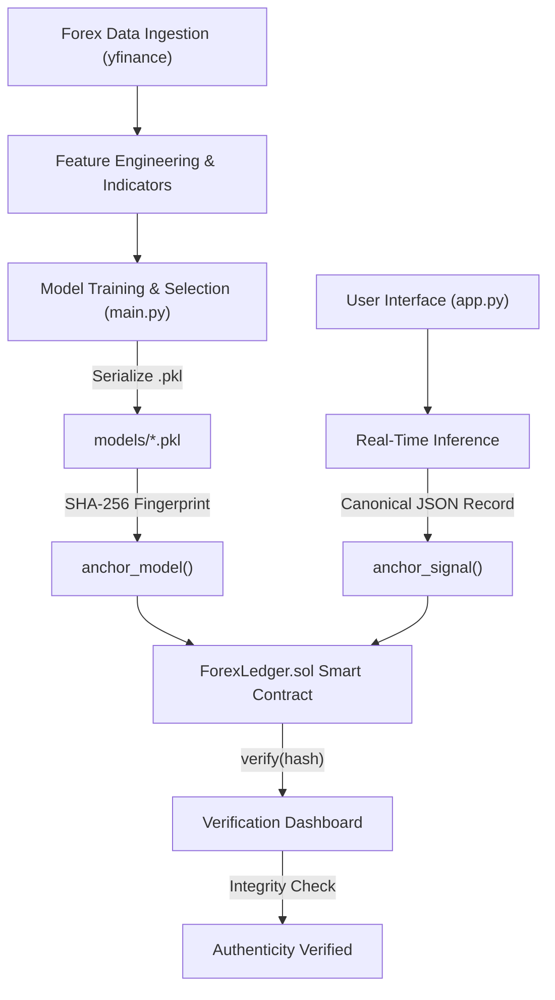

# 📈 ForexAI Chain: Machine Learning Forex Predictor with Blockchain Audit Trail

[](https://www.python.org/)
[](https://streamlit.io/)
[](https://soliditylang.org/)
[](https://web3py.readthedocs.io/)
[](https://scikit-learn.org/)

An enterprise-grade Forex market forecasting platform that combines **machine learning predictive models** with a **decentralized, tamper-proof Ethereum blockchain audit layer**. 

Every trained model and generated trade signal is cryptographically committed on-chain via SHA-256 hashes, ensuring non-repudiation, verifiable timestamping, and zero look-ahead bias without revealing proprietary weights or confidential data.

---

## 🌟 Key Features

- **📊 Market Analytics & Real-Time Data**:
  - Live FX feeds fetched dynamically via Yahoo Finance (`EURUSD`, `GBPUSD`, `USDJPY`, `USDCHF`, etc.).
  - Automated technical indicators: RSI (14), 20-period & 50-period Moving Averages, and Volume trends.
- **🤖 Machine Learning Inference Pipeline**:
  - Multi-model evaluation comparing **Random Forest**, **Gradient Boosting**, and **Logistic Regression**.
  - Dynamic feature engineering with lookback windows and automated train/test scaling.
- **⛓️ Blockchain Audit Trail (`ForexLedger.sol`)**:
  - Custom Solidity ^0.8.24 smart contract deployed to EVM.
  - Zero-knowledge design: Only 32-byte SHA-256 cryptographic commitments go on-chain.
  - Strict ownership modifiers, duplicate hash rejection (`DuplicateHash`), and immutable block timestamping.
- **🔍 Two-Way Cryptographic Verification**:
  - Real-time on-chain verification in the UI via pasted SHA-256 hashes or uploaded `.json` signal files.
  - Cryptographic payload integrity checks detect any altered data or retrospective tampering.
- **🔐 Secure Authentication & Rate Limiting**:
  - Glassmorphism login & registration interface built with Streamlit.
  - Secure password hashing with `werkzeug.security` (scrypt / PBKDF2).
  - Multi-threaded SQLite database in WAL mode with brute-force rate-limiting (10 attempts / 5-minute lockout).

---

## 🏗️ System Architecture



---

## 📁 Repository Structure

```text
├── contracts/
│   ├── ForexLedger.sol         # Solidity ^0.8.24 smart contract for audit trail
│   ├── ForexLedger_abi.json    # Compiled contract ABI (cached)
│   ├── ForexLedger_bin.txt     # Compiled contract EVM bytecode (cached)
│   └── .deployed_address       # Active deployed contract address
├── src/
│   ├── data_loader.py          # Yahoo Finance FX fetcher & technical indicator engine
│   ├── feature_engineering.py  # Lookback feature extraction and standard scaling
│   ├── models.py               # ForexPredictor model training and persistence
│   └── evaluation.py           # Model performance metric calculators
├── app.py                      # Streamlit interactive dashboard with auth & audit tools
├── auth.py                     # SQLite user registration, login, hashing, and rate limiting
├── ledger.py                   # Web3 bridge, solc compilation, and anchoring interface
├── main.py                     # Offline training pipeline with on-chain model anchoring
├── test_ledger_e2e.py          # End-to-end automated test suite for blockchain layer
├── test_app.py                 # Health-check script for data downloads
├── requirements.txt            # Python package dependencies
├── .env.example                # RPC URL and private key template
└── .gitignore                  # Git exclusions for secrets, databases, and environments
```

---

## 🚀 Quickstart Guide

### 1. Prerequisites
- **Python**: 3.10, 3.11, or 3.12
- Optional: Local [Ganache](https://trufflesuite.com/ganache/) node running on port 8545 (if absent, the platform automatically falls back to an in-memory `eth-tester` provider).

### 2. Clone and Setup Environment
```bash
git clone https://github.com/Pushkar173/Forex_Prediction_.git
cd Forex_Prediction_

# Create and activate virtual environment
python3 -m venv forex_env
source forex_env/bin/activate  # On Windows: forex_env\Scripts\activate

# Install dependencies
pip install -r requirements.txt
```

### 3. Configure Environment Variables (Optional)
Copy `.env.example` to `.env` if connecting to a dedicated Ganache or local testnet:
```bash
cp .env.example .env
```
*(Leave empty or absent to use the automatic zero-config in-memory EVM fallback).*

---

## 💻 Usage

### Step 1: Train Models & Anchor Weights on Blockchain
Run the end-to-end training pipeline:
```bash
python main.py
```
This trains the scikit-learn models on historical FX data, saves artifacts to `models/`, computes their SHA-256 digests, and registers each model on the smart contract with Ethereum transaction receipts.

### Step 2: Launch the Web Dashboard
Start the Streamlit dashboard:
```bash
streamlit run app.py
```
Open **[http://localhost:8501](http://localhost:8501)** in your browser.

- **Default Demo Account**:
  - **Email**: `admin@forex.com`
  - **Password**: `Admin@1234`
- Or click the **Sign up** tab to register your own account.

### Step 3: Run Automated Test Suite
Verify hashing, smart contract deployment, duplicate prevention, and verification:
```bash
python test_ledger_e2e.py
```

---

## 🔒 Canonical Signal Commitment Format

When a signal is generated, `app.py` compiles a deterministic JSON record:
```json
{
  "timestamp": "2026-10-25T10:00:00Z",
  "pair": "EURUSD",
  "timeframe": "1mo",
  "model": "random_forest",
  "signal": "UP",
  "confidence": 0.725,
  "input_hash": "e3b0c44298fc1c149afbf4c8996fb92427ae41e4649b934ca495991b7852b855",
  "nonce": "a1b2c3d4e5f67890"
}
```
The canonical SHA-256 fingerprint is committed to the blockchain. Users can export this JSON file and verify it anytime in the **Verify a Signal or Model on Blockchain** expander.

---

## 🛡️ Security & Disclaimers

- **Zero Plaintext Credentials**: All passwords are encrypted with one-way cryptographic salt-hashes.
- **Mainnet Protection**: `ledger.py` refuses execution against public Ethereum mainnet IDs (`chain_id=1, 56, 137, etc.`) to prevent accidental gas loss.
- **Disclaimer**: *This project is built for educational, research, and technical auditing purposes. It does not constitute financial or investment advice.*

---


